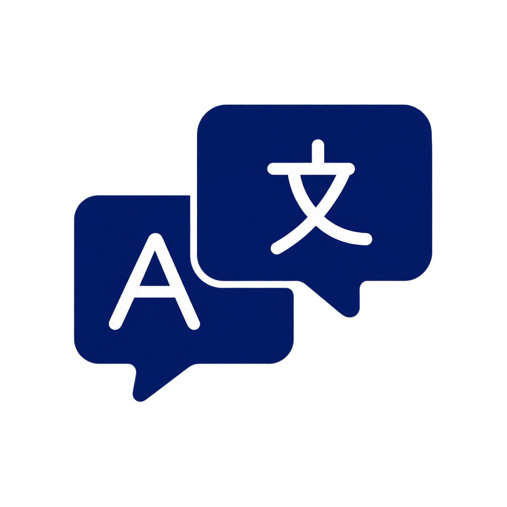

# insta-translate

On-device, real-time spoken translation for Apple Silicon.

Speak into the mic → **Qwen3-ASR** transcribes → **Hy-MT2-1.8B** translates →
**ZONOS3-Mini** speaks the result. Everything runs locally on Metal via MLX and
llama.cpp — nothing leaves the machine.



## Status

Working push-to-talk interpreter: hold the mic to speak, release to hear the
translation. Developed and verified on an **M5 MacBook Pro (24 GB)**, ~1.9–2.1 s
per turn. Built as a personal tool that can be shared; see **Hardware & memory**
below for what other machines need.

## Requirements

- **Apple Silicon Mac** (M1 or later; developed on M5)
- **macOS 14+** (16 GB RAM recommended — see memory notes)
- **Xcode Command Line Tools** (`xcode-select --install`) — to compile the app
- **[`uv`](https://docs.astral.sh/uv/)** — Python env manager
- **[`llama.cpp`](https://github.com/ggml-org/llama.cpp)** — provides
  `llama-server` for Hy-MT2 (`brew install llama.cpp`)
- ~4 GB of free disk for model weights (land in `~/.voxweft/models`)

## Quickstart

```bash
# 1. one-time setup: Python env + model downloads + toolchain check
scripts/setup.sh

# 2. start the backend (supervised: auto-restarts on crash)
scripts/backend.sh start
scripts/backend.sh status

# 3. build and launch the app
app/build.sh
open app/build/insta-translate.app
```

First run of the app: press **Connect**, choose languages, then **hold the mic
button** while you speak and release to hear the translation. Per-turn latency
chips (ASR / MT / first audio) appear under each line.

Sanity check anytime: `scripts/smoke_test.sh` runs a headless end-to-end turn
against the running backend.

> Loading happens on first call: the first translation/TTS after a fresh backend
> start includes model load. Subsequent turns are at the numbers in the table
> below.

## Hardware & memory

All three models are resident (~6–7 GB) during a session:

| Model | Size | Language coverage |
|---|---|---|
| Qwen3-ASR-1.7B (8-bit) | ~2.3 GB | ~26 ASR languages |
| Hy-MT2-1.8B (GGUF Q4_K_M) | ~1.1 GB | 36 MT languages |
| ZONOS3-Mini | ~1.3 GB | 43 TTS languages / 27 voices |

A working pair is the intersection (e.g. en↔es, en↔ja, zh↔en). The runtime
auto-ducks the mic while speaking and re-listens after playback.

### Measured latency (M5, 24 GB)

| Stage | Time |
|---|---|
| Utterance endpointing | ~0.45 s silence |
| ASR (10 s clip) | ~0.7 s |
| Hy-MT2 translation | 180–520 ms |
| ZONOS3 first audio (warm) | 95–200 ms |
| Turn (server `total_ms`) | ~1.9–2.1 s |

## Project layout

```
app/            SwiftUI macOS app (build.sh → insta-translate.app, no Xcode project)
runtime/        Python backend: vendored voxweft runtime, mini_bridge, supervisor
scripts/        setup.sh · backend.sh · smoke_test.sh · run_backend.sh
docs/           PHASE0-AUDIT.md (hardware audit that shaped the design)
tools/          small Swift probe (aec_probe.swift) for your own Mac
PLAN.md         full design history and decision log
```

## Known limitations

- **Push-to-talk only.** Acoustic echo cancellation cannot start on built-in
  MBP mic arrays (`AVAudioEngine` -10875 — see `docs/PHASE0-AUDIT.md`), so an
  always-open mic feedback-loops on its own output. AEC is **not attempted by
  default**: a failed voice-processing enable even wedges the audio session so a
  later no-AEC engine also fails to start (the mic then quietly delivers zero
  frames and every press reports "no speech"). If you have a mic where AEC
  works, opt in via `AudioEngine.preferVoiceProcessing`. The
  `tools/mic_relay.swift` tool reproduces the whole mic→server path headlessly.
  Verify with `tools/aec_probe.swift` whether *your* Mac can use open-mic mode.
- Low-resource ASR (Lao/Khmer/Burmese) is poor; pick pairs the ASR actually
  supports.
- The app is ad-hoc signed (fine for your own Mac). For distribution to others,
  see the signing/notarization notes in `THIRD_PARTY_NOTICES.md`.

## License

Our code: Apache-2.0. Third-party components (VoxWeft, ZONOS3, Qwen3-ASR,
Hy-MT2, llama.cpp, the MLX stack) each carry their own licenses — see
`THIRD_PARTY_NOTICES.md`, which also documents the two tiny patches we keep on
the vendored VoxWeft runtime.
